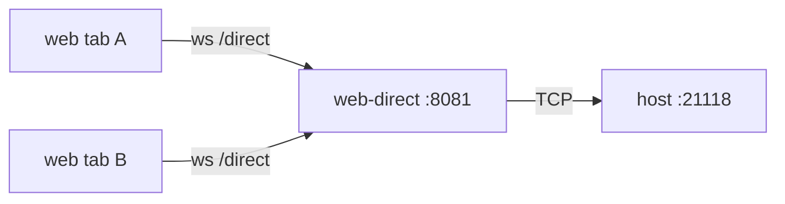

# rustdesk-web-v2-direct（v2 直连版 Web 客户端）

浏览器里**按 IP 或主机名直连**被控 RustDesk 客户端，**无需运行 hbbs/hbbr 服务器**。类似 noVNC 的 websockify 模式：一个自包含二进制，既发页面又把浏览器的 WebSocket 桥接到被控端的直连 TCP 端口。

```
浏览器 ──ws/wss──► rustdesk-web-v2-direct ──裸 TCP──► 被控:21118(直连端口)
        :8081         (页面 + WS→TCP 桥)             (开了「直接IP访问」)
```

与 `deploy/v2/web`（服务器模式）完全独立：不同 exe、不同目录，可同机不同端口并存。两者共用仓库根的 `flutter/` 树，直连由本目录 `config.js` 的 `direct: true` 打开。

**当前支持的直连 Web 客户端就是本目录。** 不要在 `deploy/v1_backup` 上继续开发（那是已退役的 v1 归档）。未来开发只用 `deploy/v2` / `deploy/v2/web-direct`。

本目录的 Go 服务器（`server/`）是与客户端版本无关的交付基础设施；内嵌的静态客户端来自当前 `flutter/` 树。归档里的 v1 直连版在 `deploy/v1_backup/web-direct/server`。

## 与服务器模式的区别

| | rustdesk-web-v2（服务器模式） | rustdesk-web-v2-direct（直连模式） |
|---|---|---|
| 寻址 | 按 ID | 按 IP 或主机名 |
| 需要 hbbs/hbbr | 需要 | **不需要** |
| 网络 | 可跨 NAT/公网（走中继） | 仅局域网/IP 可达 |
| 被控端配置 | 填服务器 + Key | 开「直接 IP 访问」 |
| 加密 | 中继加密握手 | 明文（与原生直连一致） |

## 使用

```bash
cd deploy/v2/web-direct
./build.sh                 # 构建 v2 web 客户端并编译当前平台二进制
./build.sh --all           # 交叉编译 linux/windows/macOS 单文件
# build.sh passes --no-web-resources-cdn so CanvasKit is served from the
# embedded canvaskit/ tree (Flutter 3.24 otherwise loads gstatic.com).

./rustdesk-web-v2-direct                          # http://localhost:8081
./rustdesk-web-v2-direct --listen :9000 --open    # 指定端口并自动开浏览器
./rustdesk-web-v2-direct --video-codec vp8        # ask the host to encode VP8
./rustdesk-web-v2-direct --video-ack=false        # H1 lab: login video_ack_required false
```

打开页面后，在「Remote ID」输入框里**直接填被控端的 IP 或主机名**（如 `192.168.1.50`、`192.168.1.50:21118`、`pc2023`、`office-pc.local`、`xxx.yy.com`），输入被控端密码即可连接。客户端识别到输入是 IP/主机名就自动走直连（对齐原生客户端 `is_direct_ip_access`），纯数字 ID 仍走服务器。缺省直连端口 **21118**。`localhost` / `::1` 按 `127.0.0.1` 走 `/direct`。

首次打开且尚未保存 `last_remote_id` 时，Remote ID 预填当前页面主机：`http://192.168.1.50:8081` → `192.168.1.50`，`http://localhost:8081` → `127.0.0.1`。可用 `config.js` 的 `defaultTarget` 或 `--default-target` 覆盖。不自动点 Connect；预填不使用局域网主机名（用户仍可手填主机名连接）。

Split-horizon / 内网 DNS：看起来像公网的 FQDN（`xxx.yy.com`）只要解析到私网/回环/链路本地（或 `--allow-cidr`）就允许；同一名字若解析到公网 IP，桥会拒绝（除非 `--allow-any`）。浏览器通常看不到内网 DNS，所以页面把 `hostname:port` 交给 Go 再 `LookupIP`，**先解析再套用与 IP 直连相同的 allowlist**，不会在未检查解析结果的情况下拨号。

## 被控端设置

被控端就是普通 RustDesk 客户端，开启「直接 IP 访问」：

- GUI：设置 → 网络 →「直接 IP 访问 / Direct IP access」打开（默认端口 21118，可用 `direct-access-port` 改）。
- 或配置文件 `RustDesk2.toml` 的 `[options]` 加 `direct-server = 'Y'`。
- 确保该端口对运行 `rustdesk-web-v2-direct` 的机器网络可达。

## 参数

- `--listen addr`：页面监听地址，默认 `:8081`。
- `--direct-port n`：允许的目标端口，默认 `21118`（被控端直连端口）。
- `--allow-cidr a,b,c`：允许直连的目标网段（默认仅回环/私网/链路本地）。
- `--allow-any`：关闭目标 IP 限制（**危险**：代理会变成开放 TCP 中继/SSRF，勿对公网开放）。
- `--tls-cert/--tls-key`：可选 TLS；不提供即纯 HTTP（内网/本机免证书）。
- `--base-path`、`--open`。
- `--video-codec auto|vp8|vp9`：web 端发给被控端的 decode preference（`SupportedDecoding.prefer`）。省略则保持页面默认 `auto`。web-direct 只能绘制 VP8/VP9（ogv.js）；H264/AV1/H265 请在被控端用 `rustdesk --video-codec …`，或使用原生客户端。
- `--video-ack` / `--video-ack=true|false`：web 登录 `LoginRequest.video_ack_required`。默认 `true`（与 tip 一致，省略则不注入该字段）。`--video-ack=false` 把 `videoAckRequired: false` 写入运行时 `/config.js`。详见下方 H1 lab。
- `--default-target ip`：首次访问且 `last_remote_id` 为空时预填的 Remote ID，写入运行时 `config.js` 的 `defaultTarget`，优先于页面 hostname。省略则用 `location.hostname`（`localhost`/`::1` → `127.0.0.1`）。
- `--control`：打开页面侧独占控制权（`/control` 挂在本进程 `--listen` 上，默认与页面同为 `:8081`，**不开 8099**）。默认关闭，行为与现在一致。
- `--control-auto-approve`：所有申请立刻批准（隐含 `--control`）。

房间按被控 IP 分（`192.168.1.50` 与 `192.168.1.50:21118` 同一间）。远程画面上只有底边约 32px 的半透明条；`controlroom --demo` 那种三列 JSON 页只用于调试协议，不是产品 UI。

勾选条上「下次自动批准」只对该浏览器当控制者期间有效（不随控制权交给下一个人）；命令行自动批准是全站的。

完整说明（端口对照、调试步骤）：`../controlroom/README.md`。

## 安全说明

`/direct` 是一个 WS→TCP 桥。默认只允许**回环/私网/链路本地**目标且只允许 `21118` 端口，防止它沦为开放代理。主机名会先 DNS 解析，再对**选中的解析地址**做同一套 allowlist；公网 A/AAAA 记录会被拒绝。不要用 `--allow-any` 把它暴露到不可信网络。

## LAB: H1 video ACK toggle（实验，勿合入默认）

**Throwaway lab.** 默认仍是 `video_ack_required: true`。不要把「关 ACK」当成产品行为合进 `develop`，直到 Wei 确认多路测量结果。

Hypothesis（待测）：topology A 上多路 web 直连同一被控时，login 里 `video_ack_required: true` 加上 web 在 ogv.js decode 之后才发 `video_received`，会卡住被控 `VideoFrameController::try_wait_next`，从而拖住**所有**连接的下一帧。关 ACK 后被控在送帧时立刻 `notify_video_frame_fetched`，不再等客户端 decode。



Topology A：多个浏览器标签 → 一个 `rustdesk-web-v2-direct` → 一台被控直连口。画面走这条桥；`--control` / controlroom **正交**——房间只协调谁能键鼠，不传画面、不管 ACK。可同时开：`--control --video-ack=false`。

**Host 不用重编。** 被控已按 `LoginRequest.video_ack_required` 行事（`src/server/connection.rs`）。本开关只改 web 登录请求。

### 进程级：`--video-ack=false`

```bash
./rustdesk-web-v2-direct --video-ack=false
./rustdesk-web-v2-direct --control --video-codec vp8 --video-ack=false
```

Go 把 `videoAckRequired: false` 注入运行时 `/config.js`（与 `--video-codec` / `--control` / `--default-target` 同一套 `RUSTDESK_CONFIG` 闸门）。省略或 `--video-ack` / `--video-ack=true` 时不写该字段，页面默认 `true`。Go 的 bool 旗标要用 `=` 写 false：`--video-ack=false`，不要写成 `--video-ack false`。

### 单标签 A/B：`?video_ack=0`

同一进程、不同标签，无需重启桥：

- `http://localhost:8081/?video_ack=0` 或 `?video_ack=false` → 该标签 login `false`
- `http://localhost:8081/?video_ack=1` 或 `?video_ack=true` → 强制 `true`（覆盖 config）

可选 `localStorage` 键 `rd-video-ack`（同样 `0`/`false`/`1`/`true`），优先级低于 URL。

解析顺序（高 → 低）：

1. 页面 URL `?video_ack=`
2. `localStorage['rd-video-ack']`
3. `window.RUSTDESK_CONFIG.videoAckRequired`（`--video-ack=false` 注入）
4. 默认 `true`

测量意图：两路以上 web 同时看同一被控，对比 ACK on/off 的帧间隔 / 是否整组卡住。这 **不** 替代 `--control`。

## Design notes / 以后讨论

- [同一被控主机上 web 端短时间大量连接](docs/connection-concurrency.md)（讨论稿，未实施）
